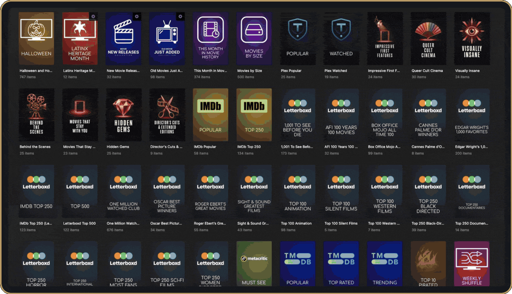

<!--
  Copyright 2025-2026 Scott Gigawatt

  SPDX-License-Identifier: Apache-2.0

  README.md: Introduce the configuration and link to operating guidance.
-->

# Kometa configuration 🎬

Personal Plex collections, custom overlays, playlists, and artwork for [Kometa](https://kometa.wiki/en/latest/). Movie franchises, TV comfort watches, and seasonal favorites get their own shelves; the posters get a wardrobe department.

<!-- markdownlint-disable MD041 -->

  <em>💫 Star this repo — could this BE any more organized?</em>

  
  
  
  

  
  
  

  
  
  

─── ⛧ ───

  <em>🎬 Posters possessed? Drag that drama through the gates of</em>
  

<!-- markdownlint-enable MD041 -->

## Start here 🎟️

This repository supplies configuration for your own Plex and Kometa deployment. Start with the guide for your task:

- **Explore the setup:** Browse [collections](docs/collections.md), [overlays](docs/overlays.md), and the [documentation index](docs/index.md).
- **Connect services:** Configure the shared runtime and credentials in [service connections](docs/service-connections.md).
- **Make a change:** Follow [contributor setup](docs/CONTRIBUTING.md#prepare-the-checkout), then the [testing guide](docs/testing.md). Rehearse before opening night.

Run repository commands from your workstation checkout. Plain `make` lists the available checks and previews.

> [!IMPORTANT]
> Keep credentials, private server addresses, logs, and generated runtime files out of Git. Use private deployment settings and the ignored `.secrets/test.env` for tests. See the [security policy](docs/SECURITY.md).

## Artwork and credits 🎨

Explore the custom [subgenre posters](assets/posters/subgenre_top/) and their [collection definitions](movies/top-rated-subgenres.yml).

[View a still image of the collection posters](assets/previews/movie-collections.jpg).

Thanks to [TheChrisK](https://github.com/TheChrisK) for original files and posters, [meisnate12](https://github.com/meisnate12) for Kometa and images, [s0len](https://github.com/s0len) for TV overlays, and [pterisaur](https://github.com/pterisaur) for people posters. Stay for the credits; these people brought the production value.

## Read more and get help 📚

- [Configuration guides](docs/index.md): collections, overlays, playlists, and service connections.
- [Testing guide](docs/testing.md): local checks and safe fixture-library previews.
- [Support](docs/SUPPORT.md), [contributing](docs/CONTRIBUTING.md), [security policy](docs/SECURITY.md), and [Code of Conduct](docs/CODE_OF_CONDUCT.md).

## License

Project source is licensed under [Apache License 2.0](LICENSE). Artwork attribution does not imply ownership of third-party images or grant rights beyond those of their creators.
